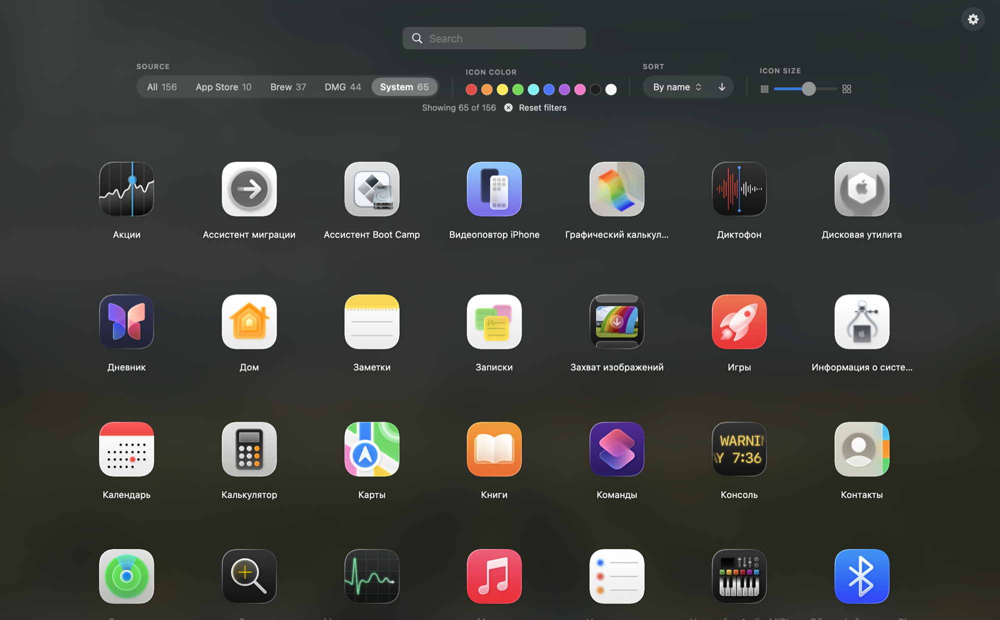

# Launchpad+

[English version](README.md)

Быстрая и удобная замена меню приложений macOS. Поиск, фильтры и сортировка по источнику установки (Brew, App Store, DMG), цвету иконки, имени, дате, частоте запусков, последнему запуску и размеру. Живёт в меню-баре, 11 языков.



## Возможности

- Открывается **щипком четырьмя пальцами**, **⌥Space** или из меню-бара
- Фильтр по **источнику** (App Store, Brew, DMG, Система) и **цвету иконки**
- Сортировка по имени, дате установки, частоте, последнему запуску, источнику, размеру
- Поиск, стрелки + Enter, меню по правому клику, размер иконок
- Автозапуск, смена языка на лету

## Скачать

1. Возьмите последний `.dmg` на странице [Releases](https://github.com/kais-blkc/launchpad_plus/releases) и перетащите **Launchpad+** в **Программы**.
2. Первый запуск: macOS напишет, что не может проверить приложение (оно не нотаризовано). Откройте *Системные настройки → Конфиденциальность и безопасность → Всё равно открыть* или выполните один раз:
   ```sh
   xattr -dr com.apple.quarantine /Applications/Launchpad+.app
   ```

Нужен macOS 14+ на Apple Silicon. Для жеста может потребоваться разрешение «Мониторинг ввода».

## Сборка из исходников

Нужны только Command Line Tools (`xcode-select --install`).

```sh
git clone https://github.com/kais-blkc/launchpad_plus.git
cd launchpad_plus
make install   # собрать и установить в /Applications
```

Другие команды: `make` (пересобрать и запустить), `make dmg` (релизный DMG), `make stop`.

## Как пользоваться

| | |
|---|---|
| Открыть / закрыть | Щипок / развести пальцы, **⌥Space**, **Esc** |
| Поиск | Просто печатайте |
| Навигация | Стрелки, **Enter** запускает |
| Настройки (язык, автозапуск, выход) | Шестерёнка справа вверху или иконка в меню-баре |

## Заметки

- Жест использует приватный API Apple `MultitouchSupport` и может сломаться после обновления macOS, хоткей продолжит работать.
- Число запусков и последний запуск берутся из Spotlight и есть не у всех приложений.
- Удаление: выйти через иконку в меню-баре и удалить приложение из «Программ».
- Новый релиз: поменять `VERSION`, затем `git tag vX.Y.Z && git push origin vX.Y.Z`.
